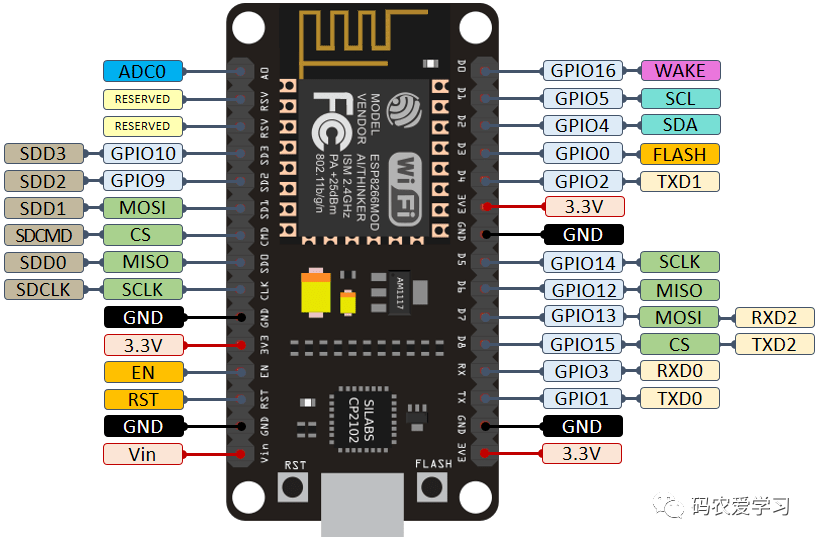
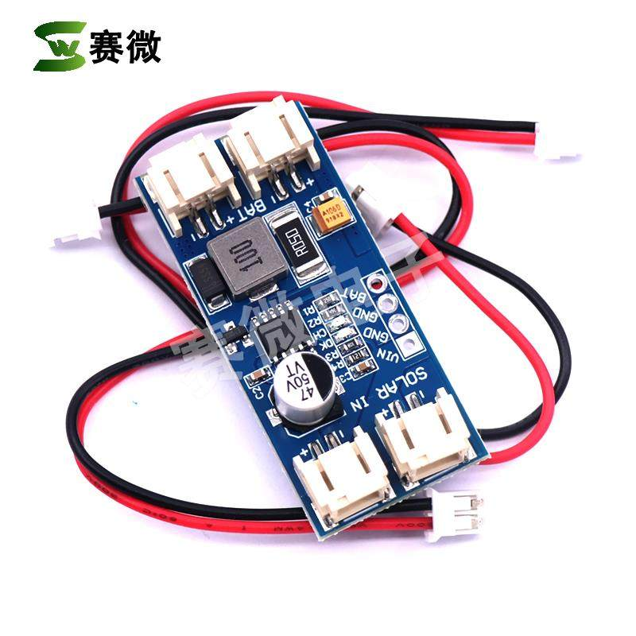
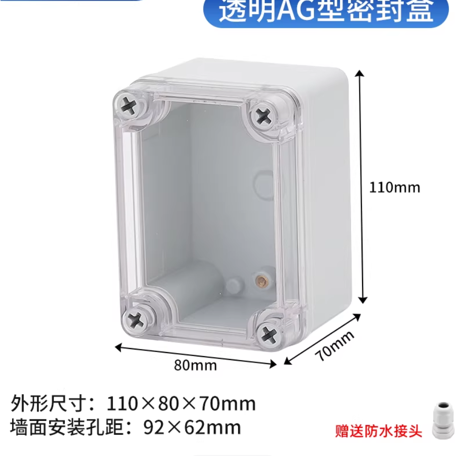

一开始只是想做个摆桌面的小气象站，看看温湿度。做着做着发现，它完全可以搬去阳台晒太阳。一月底动手，折腾了几天才定型。

## 选型

主控用 ESP8266 DevKit，这板子便宜量足，还自带 WiFi，联网上报不用额外接模块。传感器两块：DHT22 管温湿度，比入门款 DHT11 精度高不少；BMP280 管气压。供电最费脑筋——放阳台没法拉线，最后上了 CN3791 太阳能充电模块，配一块闲置的 6V 太阳能板，白天充电，晚上靠电池撑。

电路最后塞进一个 110 × 80 × 70 mm 的透明防水盒，接口封了胶。放阳台风吹日晒到现在，还没掉过链子。

## 数据链路

传感器都走 I2C 总线，两根线就接齐了，DHT22 和 BMP280 各有各的地址，读起来互不干扰。ESP8266 连上家里 WiFi 后，定时把温湿度和气压打包发出去，数据落进 Home Assistant——手机上的 HA 面板能直接看实时数值和历史曲线，省得再单独写个 App。

## 几个小坑

I2C 接错线是第一个坑，读数全 0，查了半天才发现地址没对上，先把器件地址打印出来确认，再往下写逻辑就顺了。太阳能供电在阴天也吃紧过，后来把上报间隔拉长，功耗降下来才稳。防水盒第一次封胶封太满，盖子合不严，返工了一次。

现在它安安静静待在阳台，温度、湿度、气压随时能在手机上看一眼，也不用惦记着给它换电池——太阳一出来它就自己充上了。
